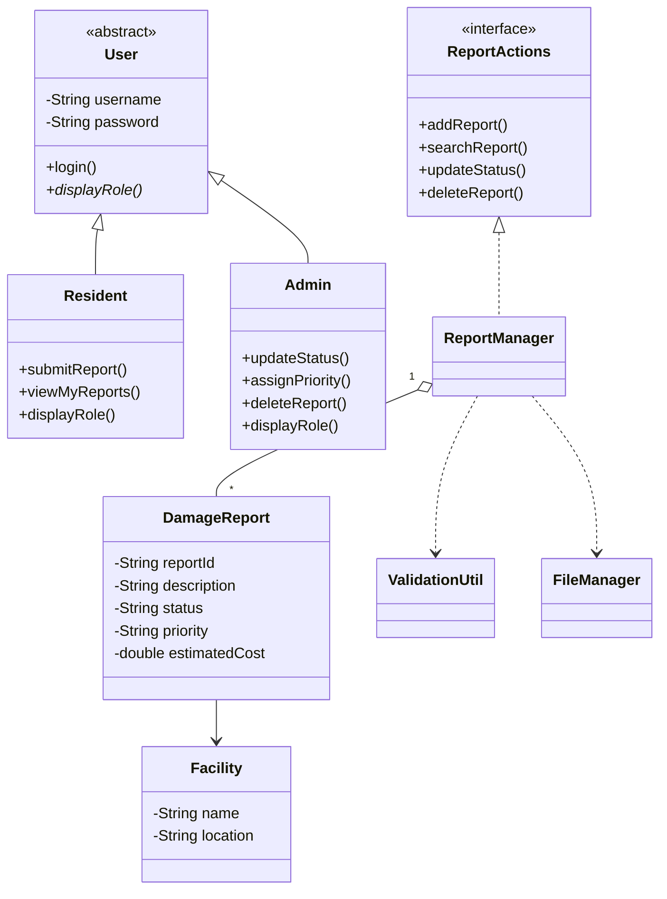
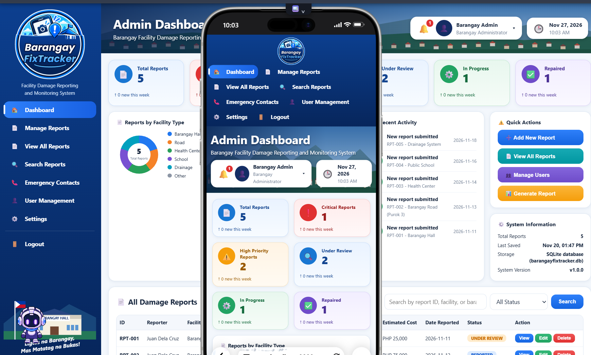
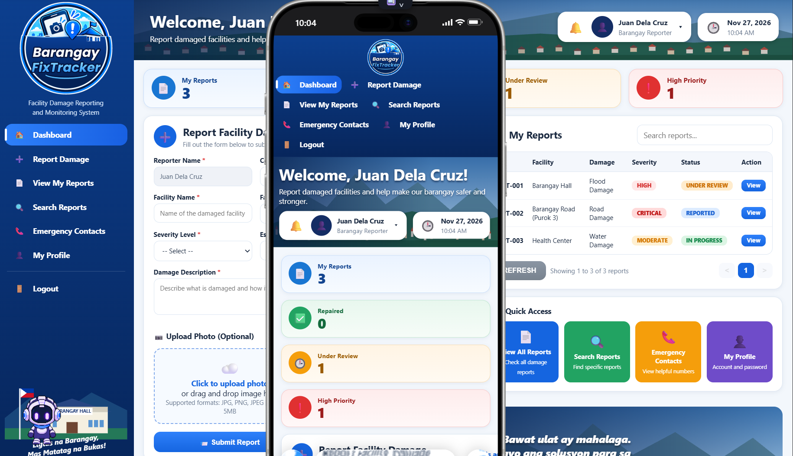
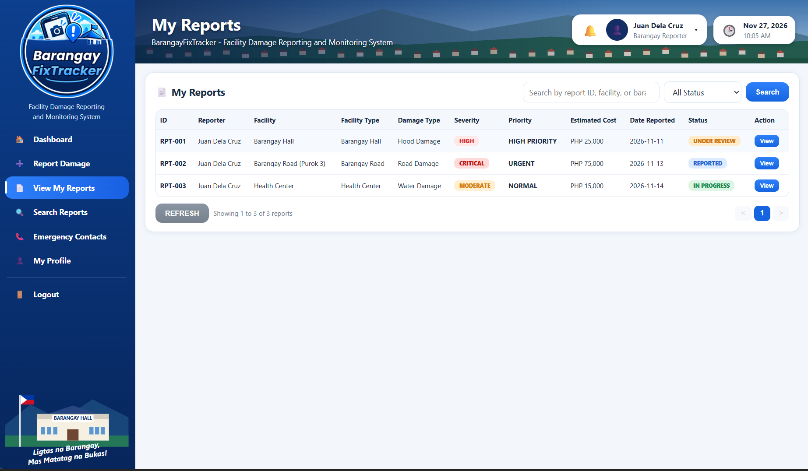

<div align="center">

# 🛠️ Barangay FixTrack

### *Report it. Track it. Fix it.* — Faster barangay repairs, one report at a time.


</div>

---

## 📖 Project Overview

Broken streetlights, flooded halls, cracked roads, leaking pipes — every barangay has them, but not every problem gets reported (or fixed) on time.

**Barangay FixTrack** is a facility damage reporting and monitoring system that connects **residents** and **barangay officials** in one place. Residents can report damaged public facilities (with a photo!), while officials review, prioritize, and update the repair status until the problem is resolved.

> 💡 *No more lost reports. No more "wala pa pong update." Just clear, trackable progress.*

---

## ✨ Project Features

| 👤 Residents | 🧑‍💼 Barangay Officials |
|---|---|
| Register and log in securely | View all submitted reports |
| Submit damage reports with details and photo | Update status: **Pending → In Progress → Resolved** |
| Track the status of their own reports | Assign priority levels (Moderate, High, Critical) |
| Search and filter reports | Delete invalid or duplicate reports |
| View emergency contacts | Dashboard with statistics and recent activity |

**Extra highlights**
- 🔔 Alarm sound when a new report is submitted
- 📊 Dashboard with stat cards and recent activity
- 🔍 Search and filter by status, facility, or priority
- ✅ Input validation and friendly error handling
- 🎨 Clean, branded interface with a custom logo

---

## 🧠 OOP Principles Applied

| Principle | How we used it |
|---|---|
| 🔒 **Encapsulation** | Class fields (e.g., in `DamageReport` and `User`) are `private`, accessed only through getters and setters with validation. |
| 🧬 **Inheritance** | `Resident` and `Admin` extend the base `User` class, reusing shared attributes and behavior. |
| 🎭 **Polymorphism** | Each user type overrides methods such as `displayRole()` to behave differently through the same `User` reference. |
| 🎯 **Abstraction** | `User` is an abstract class, and the `ReportActions` interface defines *what* the report manager must do without exposing *how*. |

Each concept is marked with comments in the source code (e.g., `// ENCAPSULATION`, `// POLYMORPHISM`) so it is easy to spot.

---

## 🗂️ Project Structure

<!-- Update this tree so it matches the actual folders and files in the repo. -->

```
TROPADEV-IT/
├── src/
│   ├── Main.java
│   ├── model/
│   │   ├── User.java            (abstract)
│   │   ├── Resident.java
│   │   ├── Admin.java
│   │   ├── Facility.java
│   │   └── DamageReport.java
│   ├── service/
│   │   ├── ReportActions.java   (interface)
│   │   ├── ReportManager.java
│   │   └── LoginManager.java
│   ├── util/
│   │   ├── FileManager.java
│   │   └── ValidationUtil.java
│   └── ui/
│       ├── Dashboard.java
│       ├── ReportForm.java
│       └── ReportTable.java
├── assets/                      (logo, images, sounds)
├── screenshots/
└── README.md
```

### 🧩 UML Class Diagram



---

## ▶️ How to Run the Program

<!-- Adjust these steps to match how your project is actually run. -->

**Requirements**
- Java JDK 17 or higher
- Any IDE (IntelliJ IDEA, NetBeans, Eclipse, VS Code) or the command line

**Steps**
```bash
# 1. Clone the repository
git clone https://github.com/ezekiellazaro/TROPADEV-IT.git

# 2. Go into the project folder
cd TROPADEV-IT

# 3. Compile
javac -d out $(find src -name "*.java")       # Windows (PowerShell): javac -d out (Get-ChildItem -Recurse src -Filter *.java).FullName

# 4. Run
java -cp out Main
```

**Sample logins**

| Role | Username | Password |
|---|---|---|
| Admin | `admin` | `admin123` |
| Resident | `resident` | `resident123` |

---

## 📸 Sample Screenshots / Output / Highlights

### 🧑‍💼 Admin Dashboard
Officials get a bird's-eye view of every report: total, critical, high priority, under review, in progress, and repaired. They also get a facility-type chart, recent activity, quick actions, and system info.



### 🙋 Resident Dashboard & Report Form
Residents can report damaged facilities in seconds: facility name, severity, description, and an optional photo upload. Their own report stats and quick-access shortcuts sit on the same page.



### 📋 My Reports
Residents can follow each report's severity, priority, estimated cost, and status (**Reported → Under Review → In Progress → Repaired**), and search or filter by status.



### 📱 Responsive Design
The interface adapts to phones too, as shown by the mobile view overlaid on the dashboards above.

---

## 💌 Thank You!

Thank you for taking the time to explore **Barangay FixTrack**! We built this project to show that even small lines of code can help a community, and that good OOP design makes that code easier to grow, fix, and understand.

If you liked it, please leave a ⭐ on the repo. 💙

---

## 👥 Team Members — **TROPADEV** (Team 6, BSIT-2106)

| Name | GitHub |
|---|---|
| **Catapang, Hannah D.** | [@catapanghannah](https://github.com/catapanghannah) |
| **Lazaro, Ezekiel A.** | [@ezekiellazaro](https://github.com/ezekiellazaro) |
| **Piañar, Alexandra A.** | <!-- add GitHub link --> |
| **Roxas, Nycka M.** | <!-- add GitHub link --> |

---

## 🙏 Acknowledgment

We sincerely thank **Ms. Fatima Marie P. Agdon, MSCS**, our OOP 101 instructor, for her guidance, patience, and for encouraging us to think creatively in applying object-oriented principles.

Thanks also to the **Batangas State University – Alangilan** community, to our families and friends for their support, and to every barangay worker who keeps our communities running. This project is for you. 🇵🇭

---

<div align="center">

*Made with ☕, 💻, and a lot of teamwork by **TROPADEV***

</div>
