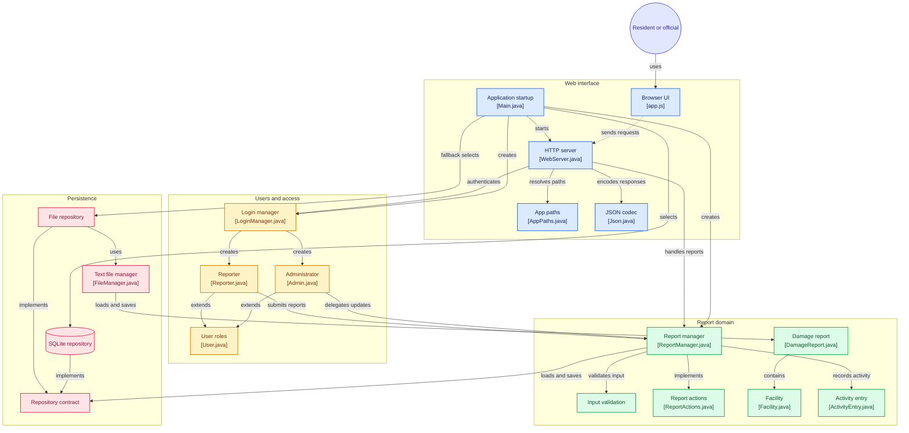

<p align="center">
  
</p>

# 🛠️TROPADEV-IT: Barangay FixTrack🚧🛠️

**OOP 101 - Object-Oriented Programming** | BSIT-2106 | Team 6 (TROPADEV-IT)
Batangas State University, The National Engineering University, Alangilan Campus

Barangay FixTrack🔎 is a Java-based web system where residents report damaged barangay facilities and barangay officials review, update and monitor the reports until they are resolved.

## OOP Concepts Demonstrated

| OOP Concept | How it was demonstrated |
|---|---|
| **Encapsulation** | The attributes of `User`, `DamageReport` and `Facility` are declared `private` and accessed only through getters and setters. `ValidationUtil` checks inputs before they are stored, so invalid or missing data cannot reach the report. |
| **Inheritance** | `Reporter` and `Admin` extend the parent class `User`. They reuse its shared attributes and methods (such as `login()` and `logout()`) and add features of their own, calling the parent constructor with `super()`. |
| **Polymorphism** | `Reporter` and `Admin` override the `User` methods that differ by role. A `User` reference can hold either one, and the correct version runs at runtime, so the main menu shows resident or official options depending on who logged in. |
| **Abstraction** | The `ReportActions` interface defines the report operations without saying how they work. The `ReportRepository` interface hides how reports are stored, so `ReportManager` works the same whether data is saved by `SqliteReportRepository` or `FileReportRepository`. |

## Team Members and Assigned Tasks

| Member | SR-Code | GitHub | Role | Assigned Tasks |
|---|---|---|---|---|
| Catapang, Hannah D. | 25-02798 | catapanghannah | Backend + Frontend | Damage Report Submission and Photo Upload. `Resident` and `Facility` classes, `submitReport()` and `viewReport()`, input validation, exception handling for invalid or missing inputs. |
| Lazaro, Ezekiel A. | 25-09214 | ezekiellazaro | Project Lead, Backend | Core system. `User` parent class (inheritance and polymorphism), `login()` and `logout()`, main menu and program flow. Manages this repository and merges the team's code. |
| Piañar, Alexandra A. | 25-06977 | Alexandra Pianar | Backend + Frontend | Barangay Official features. `Barangay Officials` class, `reviewReport()` and `updateStatus()`, Search and Filter, Dashboard summary of reports. |
| Roxas, Nycka M. | 25-00982 | Nycka-Roxas28 | Database, Testing, Docs | Data handling (arrays/data structures), SQLite storage, testing and debugging, documentation, slides and final presentation. |

## Project Structure

```
BarangayFixTrackerWeb/
├── frontend/   Website (index.html, app.js, style.css, images)
├── backend/
│   ├── src/    Java source code (model, service, util, interfaces, web)
│   └── lib/    SQLite driver .jar (downloaded automatically by run.bat / run.sh)
├── database/   schema.sql (table design); the .db file and photos are created on run
├── run.bat     Windows: compile and start
└── run.sh      Mac/Linux: compile and start
```

### Who owns which files

| Member | Files |
|---|---|
| Hannah | `model/Reporter.java`, `model/Facility.java`, `util/ValidationUtil.java`, report form and photo upload in `frontend/` |
| Ezekiel | `model/User.java`, `service/LoginManager.java`, `interfaces/ReportActions.java`, `web/Main.java`, `web/WebServer.java`, `web/AppPaths.java` |
| Alexandra | `model/Admin.java`, `model/ActivityEntry.java`, dashboard, search/filter and status update in `frontend/` |
| Nycka | `model/DamageReport.java`, `service/ReportManager.java`, `service/ReportRepository.java`, `service/SqliteReportRepository.java`, `service/FileReportRepository.java`, `service/FileManager.java`, `database/`, docs |

## How to Run

1. Install a JDK (11 or newer).
2. Windows: double-click `run.bat` | Mac/Linux: `./run.sh`
3. Open http://localhost:8080

Logins: Admin `admin` / `admin123`, Reporter `resident` / `resident123`

The first run downloads the SQLite driver (internet needed once). See `README.txt` for details.

## Git Workflow

1. `git pull origin main` before working.
2. Work on your own branch (e.g. `hannah-validation`).
3. Commit small changes with clear messages.
4. Open a Pull Request; Ezekiel reviews and merges.

## UML Class Diagram


