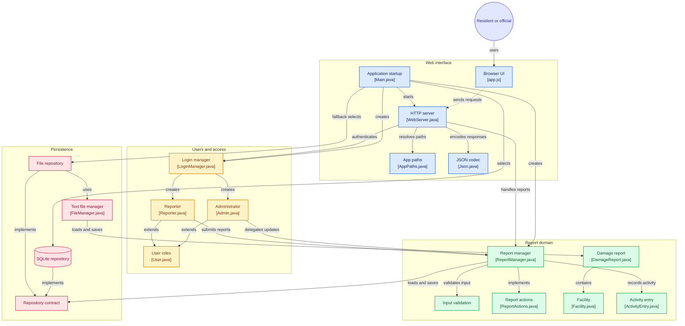

</p> 
<svg xmlns="http://www.w3.org/2000/svg" viewBox="0 0 1200 630" width="1200" height="630" role="img" aria-label="Barangay FixTrack banner" xmlns:c2pa="http://c2pa.org/manifest">
<defs>
<linearGradient id="sky" x1="0" y1="0" x2="0" y2="1"><stop offset="0" stop-color="#070330"/><stop offset="0.6" stop-color="#1a0f6e"/><stop offset="1" stop-color="#2a1a9a"/></linearGradient>
<linearGradient id="title" x1="0" y1="0" x2="1" y2="1"><stop offset="0" stop-color="#ffb21e"/><stop offset="0.45" stop-color="#ff7a1a"/><stop offset="0.55" stop-color="#19e6ff"/><stop offset="1" stop-color="#7b5cff"/></linearGradient>
<linearGradient id="floor" x1="0" y1="0" x2="0" y2="1"><stop offset="0" stop-color="#3b1fd6" stop-opacity="0.2"/><stop offset="1" stop-color="#1a0a70" stop-opacity="0.9"/></linearGradient>
<filter id="glow" x="-20%" y="-20%" width="140%" height="140%"><feGaussianBlur stdDeviation="6" result="b"><animate attributeName="stdDeviation" values="3;10;3" dur="3s" repeatCount="indefinite"/></feGaussianBlur><feMerge><feMergeNode in="b"/><feMergeNode in="SourceGraphic"/></feMerge></filter>
<clipPath id="r"><rect width="1200" height="630" rx="16"/></clipPath>
</defs>
<g clip-path="url(#r)">
<rect width="1200" height="630" fill="url(#sky)"/>
<rect x="673" y="87" width="4" height="4" fill="#fff" opacity="1"><animate attributeName="opacity" values="1;0.15;1" dur="3.1s" begin="0.2s" repeatCount="indefinite"/></rect>
<rect x="1107" y="58" width="3" height="3" fill="#fff" opacity="1"><animate attributeName="opacity" values="1;0.15;1" dur="3.0s" begin="2.7s" repeatCount="indefinite"/></rect>
<rect x="449" y="29" width="2" height="2" fill="#fff" opacity="1"><animate attributeName="opacity" values="1;0.15;1" dur="2.6s" begin="0.2s" repeatCount="indefinite"/></rect>
<rect x="195" y="292" width="4" height="4" fill="#fff" opacity="1"><animate attributeName="opacity" values="1;0.15;1" dur="1.6s" begin="1.7s" repeatCount="indefinite"/></rect>
<rect x="467" y="332" width="2" height="2" fill="#fff" opacity="1"><animate attributeName="opacity" values="1;0.15;1" dur="2.9s" begin="1.2s" repeatCount="indefinite"/></rect>
<rect x="462" y="33" width="2" height="2" fill="#fff" opacity="1"><animate attributeName="opacity" values="1;0.15;1" dur="2.2s" begin="0.4s" repeatCount="indefinite"/></rect>
<rect x="251" y="302" width="3" height="3" fill="#fff" opacity="1"><animate attributeName="opacity" values="1;0.15;1" dur="2.9s" begin="2.0s" repeatCount="indefinite"/></rect>
<rect x="221" y="307" width="2" height="2" fill="#fff" opacity="1"><animate attributeName="opacity" values="1;0.15;1" dur="2.4s" begin="1.6s" repeatCount="indefinite"/></rect>
<rect x="138" y="298" width="2" height="2" fill="#fff" opacity="1"><animate attributeName="opacity" values="1;0.15;1" dur="3.0s" begin="1.5s" repeatCount="indefinite"/></rect>
<rect x="1098" y="228" width="3" height="3" fill="#fff" opacity="1"><animate attributeName="opacity" values="1;0.15;1" dur="2.7s" begin="2.8s" repeatCount="indefinite"/></rect>
<rect x="750" y="163" width="2" height="2" fill="#fff" opacity="1"><animate attributeName="opacity" values="1;0.15;1" dur="3.5s" begin="2.1s" repeatCount="indefinite"/></rect>
<rect x="509" y="51" width="3" height="3" fill="#fff" opacity="1"><animate attributeName="opacity" values="1;0.15;1" dur="2.8s" begin="2.6s" repeatCount="indefinite"/></rect>
<rect x="929" y="157" width="2" height="2" fill="#fff" opacity="1"><animate attributeName="opacity" values="1;0.15;1" dur="1.8s" begin="1.3s" repeatCount="indefinite"/></rect>
<rect x="710" y="87" width="4" height="4" fill="#fff" opacity="1"><animate attributeName="opacity" values="1;0.15;1" dur="2.6s" begin="2.9s" repeatCount="indefinite"/></rect>
<rect x="168" y="295" width="3" height="3" fill="#fff" opacity="1"><animate attributeName="opacity" values="1;0.15;1" dur="2.4s" begin="1.1s" repeatCount="indefinite"/></rect>
<rect x="1027" y="306" width="4" height="4" fill="#fff" opacity="1"><animate attributeName="opacity" values="1;0.15;1" dur="1.7s" begin="0.3s" repeatCount="indefinite"/></rect>
<rect x="562" y="252" width="2" height="2" fill="#fff" opacity="1"><animate attributeName="opacity" values="1;0.15;1" dur="1.7s" begin="2.1s" repeatCount="indefinite"/></rect>
<rect x="922" y="155" width="4" height="4" fill="#fff" opacity="1"><animate attributeName="opacity" values="1;0.15;1" dur="3.7s" begin="1.0s" repeatCount="indefinite"/></rect>
<rect x="955" y="191" width="2" height="2" fill="#fff" opacity="1"><animate attributeName="opacity" values="1;0.15;1" dur="3.0s" begin="1.5s" repeatCount="indefinite"/></rect>
<rect x="456" y="157" width="2" height="2" fill="#fff" opacity="1"><animate attributeName="opacity" values="1;0.15;1" dur="3.3s" begin="1.2s" repeatCount="indefinite"/></rect>
<rect x="1026" y="51" width="2" height="2" fill="#fff" opacity="1"><animate attributeName="opacity" values="1;0.15;1" dur="2.6s" begin="1.6s" repeatCount="indefinite"/></rect>
<rect x="290" y="230" width="3" height="3" fill="#fff" opacity="1"><animate attributeName="opacity" values="1;0.15;1" dur="3.3s" begin="3.0s" repeatCount="indefinite"/></rect>
<rect x="789" y="128" width="2" height="2" fill="#fff" opacity="1"><animate attributeName="opacity" values="1;0.15;1" dur="1.7s" begin="0.5s" repeatCount="indefinite"/></rect>
<rect x="487" y="16" width="4" height="4" fill="#fff" opacity="1"><animate attributeName="opacity" values="1;0.15;1" dur="3.6s" begin="0.5s" repeatCount="indefinite"/></rect>
<rect x="587" y="12" width="2" height="2" fill="#fff" opacity="1"><animate attributeName="opacity" values="1;0.15;1" dur="2.5s" begin="1.1s" repeatCount="indefinite"/></rect>
<rect x="1169" y="173" width="2" height="2" fill="#fff" opacity="1"><animate attributeName="opacity" values="1;0.15;1" dur="3.2s" begin="1.5s" repeatCount="indefinite"/></rect>
<rect x="120" y="243" width="4" height="4" fill="#fff" opacity="1"><animate attributeName="opacity" values="1;0.15;1" dur="2.5s" begin="1.2s" repeatCount="indefinite"/></rect>
<rect x="996" y="334" width="4" height="4" fill="#fff" opacity="1"><animate attributeName="opacity" values="1;0.15;1" dur="1.7s" begin="0.2s" repeatCount="indefinite"/></rect>
<rect x="437" y="235" width="2" height="2" fill="#fff" opacity="1"><animate attributeName="opacity" values="1;0.15;1" dur="1.8s" begin="1.8s" repeatCount="indefinite"/></rect>
<rect x="219" y="10" width="2" height="2" fill="#fff" opacity="1"><animate attributeName="opacity" values="1;0.15;1" dur="2.8s" begin="2.8s" repeatCount="indefinite"/></rect>
<rect x="62" y="46" width="2" height="2" fill="#fff" opacity="1"><animate attributeName="opacity" values="1;0.15;1" dur="3.0s" begin="0.4s" repeatCount="indefinite"/></rect>
<rect x="526" y="187" width="3" height="3" fill="#fff" opacity="1"><animate attributeName="opacity" values="1;0.15;1" dur="2.7s" begin="0.3s" repeatCount="indefinite"/></rect>
<rect x="1009" y="248" width="4" height="4" fill="#fff" opacity="1"><animate attributeName="opacity" values="1;0.15;1" dur="2.7s" begin="0.3s" repeatCount="indefinite"/></rect>
<rect x="219" y="393" width="3" height="3" fill="#fff" opacity="1"><animate attributeName="opacity" values="1;0.15;1" dur="3.4s" begin="1.4s" repeatCount="indefinite"/></rect>
<rect x="340" y="274" width="2" height="2" fill="#fff" opacity="1"><animate attributeName="opacity" values="1;0.15;1" dur="2.0s" begin="2.9s" repeatCount="indefinite"/></rect>
<rect x="750" y="85" width="2" height="2" fill="#fff" opacity="1"><animate attributeName="opacity" values="1;0.15;1" dur="3.4s" begin="0.9s" repeatCount="indefinite"/></rect>
<rect x="196" y="366" width="3" height="3" fill="#fff" opacity="1"><animate attributeName="opacity" values="1;0.15;1" dur="2.8s" begin="2.7s" repeatCount="indefinite"/></rect>
<rect x="738" y="124" width="3" height="3" fill="#fff" opacity="1"><animate attributeName="opacity" values="1;0.15;1" dur="3.1s" begin="1.8s" repeatCount="indefinite"/></rect>
<rect x="409" y="132" width="4" height="4" fill="#fff" opacity="1"><animate attributeName="opacity" values="1;0.15;1" dur="3.3s" begin="0.7s" repeatCount="indefinite"/></rect>
<rect x="1070" y="262" width="3" height="3" fill="#fff" opacity="1"><animate attributeName="opacity" values="1;0.15;1" dur="3.3s" begin="3.0s" repeatCount="indefinite"/></rect>
<rect x="582" y="251" width="3" height="3" fill="#fff" opacity="1"><animate attributeName="opacity" values="1;0.15;1" dur="2.0s" begin="1.8s" repeatCount="indefinite"/></rect>
<rect x="715" y="238" width="3" height="3" fill="#fff" opacity="1"><animate attributeName="opacity" values="1;0.15;1" dur="3.9s" begin="1.1s" repeatCount="indefinite"/></rect>
<rect x="461" y="62" width="2" height="2" fill="#fff" opacity="1"><animate attributeName="opacity" values="1;0.15;1" dur="2.7s" begin="1.0s" repeatCount="indefinite"/></rect>
<rect x="998" y="329" width="2" height="2" fill="#fff" opacity="1"><animate attributeName="opacity" values="1;0.15;1" dur="2.7s" begin="2.0s" repeatCount="indefinite"/></rect>
<rect x="183" y="348" width="2" height="2" fill="#fff" opacity="1"><animate attributeName="opacity" values="1;0.15;1" dur="3.8s" begin="2.3s" repeatCount="indefinite"/></rect>
<rect x="418" y="254" width="2" height="2" fill="#fff" opacity="1"><animate attributeName="opacity" values="1;0.15;1" dur="2.6s" begin="1.9s" repeatCount="indefinite"/></rect>
<rect x="187" y="379" width="4" height="4" fill="#fff" opacity="1"><animate attributeName="opacity" values="1;0.15;1" dur="2.7s" begin="2.2s" repeatCount="indefinite"/></rect>
<rect x="183" y="381" width="2" height="2" fill="#fff" opacity="1"><animate attributeName="opacity" values="1;0.15;1" dur="1.9s" begin="0.4s" repeatCount="indefinite"/></rect>
<rect x="319" y="312" width="4" height="4" fill="#fff" opacity="1"><animate attributeName="opacity" values="1;0.15;1" dur="3.5s" begin="0.4s" repeatCount="indefinite"/></rect>
<rect x="981" y="346" width="3" height="3" fill="#fff" opacity="1"><animate attributeName="opacity" values="1;0.15;1" dur="1.9s" begin="1.6s" repeatCount="indefinite"/></rect>
<rect x="53" y="17" width="2" height="2" fill="#fff" opacity="1"><animate attributeName="opacity" values="1;0.15;1" dur="2.8s" begin="2.8s" repeatCount="indefinite"/></rect>
<rect x="898" y="109" width="2" height="2" fill="#fff" opacity="1"><animate attributeName="opacity" values="1;0.15;1" dur="1.6s" begin="0.6s" repeatCount="indefinite"/></rect>
<rect x="1036" y="133" width="3" height="3" fill="#fff" opacity="1"><animate attributeName="opacity" values="1;0.15;1" dur="2.1s" begin="1.3s" repeatCount="indefinite"/></rect>
<rect x="278" y="41" width="3" height="3" fill="#fff" opacity="1"><animate attributeName="opacity" values="1;0.15;1" dur="3.7s" begin="2.0s" repeatCount="indefinite"/></rect>
<rect x="1068" y="225" width="2" height="2" fill="#fff" opacity="1"><animate attributeName="opacity" values="1;0.15;1" dur="2.8s" begin="1.6s" repeatCount="indefinite"/></rect>
<rect x="48" y="235" width="2" height="2" fill="#fff" opacity="1"><animate attributeName="opacity" values="1;0.15;1" dur="3.0s" begin="2.3s" repeatCount="indefinite"/></rect>
<rect x="316" y="98" width="2" height="2" fill="#fff" opacity="1"><animate attributeName="opacity" values="1;0.15;1" dur="2.7s" begin="2.2s" repeatCount="indefinite"/></rect>
<rect x="1149" y="41" width="3" height="3" fill="#fff" opacity="1"><animate attributeName="opacity" values="1;0.15;1" dur="3.2s" begin="1.6s" repeatCount="indefinite"/></rect>
<rect x="998" y="64" width="2" height="2" fill="#fff" opacity="1"><animate attributeName="opacity" values="1;0.15;1" dur="2.1s" begin="0.8s" repeatCount="indefinite"/></rect>
<rect x="210" y="269" width="4" height="4" fill="#fff" opacity="1"><animate attributeName="opacity" values="1;0.15;1" dur="2.9s" begin="2.3s" repeatCount="indefinite"/></rect>
<rect x="139" y="236" width="3" height="3" fill="#fff" opacity="1"><animate attributeName="opacity" values="1;0.15;1" dur="3.0s" begin="1.5s" repeatCount="indefinite"/></rect>
<rect x="1058" y="112" width="3" height="3" fill="#fff" opacity="1"><animate attributeName="opacity" values="1;0.15;1" dur="2.6s" begin="1.6s" repeatCount="indefinite"/></rect>
<rect x="989" y="269" width="2" height="2" fill="#fff" opacity="1"><animate attributeName="opacity" values="1;0.15;1" dur="3.2s" begin="2.6s" repeatCount="indefinite"/></rect>
<rect x="541" y="296" width="2" height="2" fill="#fff" opacity="1"><animate attributeName="opacity" values="1;0.15;1" dur="3.6s" begin="0.4s" repeatCount="indefinite"/></rect>
<rect x="259" y="210" width="4" height="4" fill="#fff" opacity="1"><animate attributeName="opacity" values="1;0.15;1" dur="2.3s" begin="2.0s" repeatCount="indefinite"/></rect>
<rect x="887" y="47" width="2" height="2" fill="#fff" opacity="1"><animate attributeName="opacity" values="1;0.15;1" dur="3.2s" begin="2.4s" repeatCount="indefinite"/></rect>
<rect x="326" y="376" width="3" height="3" fill="#fff" opacity="1"><animate attributeName="opacity" values="1;0.15;1" dur="1.9s" begin="2.6s" repeatCount="indefinite"/></rect>
<rect x="967" y="122" width="2" height="2" fill="#fff" opacity="1"><animate attributeName="opacity" values="1;0.15;1" dur="2.5s" begin="1.5s" repeatCount="indefinite"/></rect>
<rect x="468" y="92" width="4" height="4" fill="#fff" opacity="1"><animate attributeName="opacity" values="1;0.15;1" dur="4.0s" begin="1.2s" repeatCount="indefinite"/></rect>
<rect x="872" y="110" width="3" height="3" fill="#fff" opacity="1"><animate attributeName="opacity" values="1;0.15;1" dur="2.3s" begin="2.2s" repeatCount="indefinite"/></rect>
<rect x="49" y="183" width="4" height="4" fill="#fff" opacity="1"><animate attributeName="opacity" values="1;0.15;1" dur="2.6s" begin="0.1s" repeatCount="indefinite"/></rect>
<rect x="688" y="274" width="3" height="3" fill="#fff" opacity="1"><animate attributeName="opacity" values="1;0.15;1" dur="2.8s" begin="0.2s" repeatCount="indefinite"/></rect>
<rect x="478" y="63" width="2" height="2" fill="#fff" opacity="1"><animate attributeName="opacity" values="1;0.15;1" dur="2.2s" begin="0.1s" repeatCount="indefinite"/></rect>
<rect x="381" y="148" width="2" height="2" fill="#fff" opacity="1"><animate attributeName="opacity" values="1;0.15;1" dur="3.5s" begin="2.5s" repeatCount="indefinite"/></rect>
<rect x="539" y="217" width="2" height="2" fill="#fff" opacity="1"><animate attributeName="opacity" values="1;0.15;1" dur="2.8s" begin="1.5s" repeatCount="indefinite"/></rect>
<rect x="1022" y="368" width="3" height="3" fill="#fff" opacity="1"><animate attributeName="opacity" values="1;0.15;1" dur="1.7s" begin="0.2s" repeatCount="indefinite"/></rect>
<rect x="385" y="227" width="2" height="2" fill="#fff" opacity="1"><animate attributeName="opacity" values="1;0.15;1" dur="2.2s" begin="0.1s" repeatCount="indefinite"/></rect>
<rect x="191" y="143" width="2" height="2" fill="#fff" opacity="1"><animate attributeName="opacity" values="1;0.15;1" dur="3.0s" begin="0.7s" repeatCount="indefinite"/></rect>
<rect x="551" y="72" width="4" height="4" fill="#fff" opacity="1"><animate attributeName="opacity" values="1;0.15;1" dur="1.5s" begin="3.0s" repeatCount="indefinite"/></rect>
<rect x="865" y="147" width="2" height="2" fill="#fff" opacity="1"><animate attributeName="opacity" values="1;0.15;1" dur="1.6s" begin="2.1s" repeatCount="indefinite"/></rect>
<rect x="234" y="92" width="3" height="3" fill="#fff" opacity="1"><animate attributeName="opacity" values="1;0.15;1" dur="1.6s" begin="0.6s" repeatCount="indefinite"/></rect>
<rect x="648" y="331" width="3" height="3" fill="#fff" opacity="1"><animate attributeName="opacity" values="1;0.15;1" dur="2.8s" begin="0.6s" repeatCount="indefinite"/></rect>
<rect x="922" y="266" width="2" height="2" fill="#fff" opacity="1"><animate attributeName="opacity" values="1;0.15;1" dur="2.2s" begin="2.4s" repeatCount="indefinite"/></rect>
<rect x="522" y="28" width="2" height="2" fill="#fff" opacity="1"><animate attributeName="opacity" values="1;0.15;1" dur="1.5s" begin="1.5s" repeatCount="indefinite"/></rect>
<rect x="398" y="273" width="4" height="4" fill="#fff" opacity="1"><animate attributeName="opacity" values="1;0.15;1" dur="2.1s" begin="1.3s" repeatCount="indefinite"/></rect>
<rect x="895" y="346" width="4" height="4" fill="#fff" opacity="1"><animate attributeName="opacity" values="1;0.15;1" dur="2.9s" begin="2.7s" repeatCount="indefinite"/></rect>
<rect x="1047" y="167" width="2" height="2" fill="#fff" opacity="1"><animate attributeName="opacity" values="1;0.15;1" dur="4.0s" begin="1.0s" repeatCount="indefinite"/></rect>
<rect x="296" y="217" width="3" height="3" fill="#fff" opacity="1"><animate attributeName="opacity" values="1;0.15;1" dur="4.0s" begin="2.5s" repeatCount="indefinite"/></rect>
<rect x="39" y="46" width="3" height="3" fill="#fff" opacity="1"><animate attributeName="opacity" values="1;0.15;1" dur="2.6s" begin="0.2s" repeatCount="indefinite"/></rect>
<rect x="790" y="269" width="3" height="3" fill="#fff" opacity="1"><animate attributeName="opacity" values="1;0.15;1" dur="3.0s" begin="2.1s" repeatCount="indefinite"/></rect>
<path d="M520 76L523 87L534 90L523 93L520 104L517 93L506 90L517 87Z" fill="#fff"><animate attributeName="opacity" values="1;0.2;1" dur="2.2s" repeatCount="indefinite"/></path>
<path d="M930 196L933 207L944 210L933 213L930 224L927 213L916 210L927 207Z" fill="#fff"><animate attributeName="opacity" values="1;0.2;1" dur="2.2s" repeatCount="indefinite"/></path>
<path d="M210 246L213 257L224 260L213 263L210 274L207 263L196 260L207 257Z" fill="#fff"><animate attributeName="opacity" values="1;0.2;1" dur="2.2s" repeatCount="indefinite"/></path>
<path d="M760 56L763 67L774 70L763 73L760 84L757 73L746 70L757 67Z" fill="#fff"><animate attributeName="opacity" values="1;0.2;1" dur="2.2s" repeatCount="indefinite"/></path>
<g><animateTransform attributeName="transform" type="translate" values="0 0;28 0;0 0" dur="14s" repeatCount="indefinite"/>
<rect x="60" y="40" width="60" height="10" fill="#cfe3ff"/>
<rect x="50" y="50" width="80" height="10" fill="#cfe3ff"/>
<rect x="40" y="60" width="100" height="10" fill="#cfe3ff"/>
<rect x="40" y="70" width="100" height="10" fill="#cfe3ff"/>
<rect x="50" y="80" width="80" height="10" fill="#cfe3ff"/>
<rect x="70" y="50" width="30" height="10" fill="#fff"/>
<rect x="50" y="80" width="80" height="10" fill="#8fa8ff"/>
</g>
<g><animateTransform attributeName="transform" type="translate" values="0 0;-28 0;0 0" dur="16s" repeatCount="indefinite"/>
<rect x="1048" y="50" width="54" height="9" fill="#cfe3ff"/>
<rect x="1039" y="59" width="72" height="9" fill="#cfe3ff"/>
<rect x="1030" y="68" width="90" height="9" fill="#cfe3ff"/>
<rect x="1030" y="77" width="90" height="9" fill="#cfe3ff"/>
<rect x="1039" y="86" width="72" height="9" fill="#cfe3ff"/>
<rect x="1057" y="59" width="27" height="9" fill="#fff"/>
<rect x="1039" y="86" width="72" height="9" fill="#8fa8ff"/>
</g>
<g><animate attributeName="opacity" values="0.55;1;0.55" dur="3s" repeatCount="indefinite"/>
<rect x="0" y="420" width="1200" height="210" fill="url(#floor)"/>
<line x1="0" y1="420" x2="1200" y2="420" stroke="#6a8bff" stroke-width="2"/>
<line x1="180" y1="420" x2="-1500" y2="630" stroke="#3d6bff" stroke-width="2" opacity="0.8"/>
<line x1="210" y1="420" x2="-1350" y2="630" stroke="#3d6bff" stroke-width="2" opacity="0.8"/>
<line x1="240" y1="420" x2="-1200" y2="630" stroke="#3d6bff" stroke-width="2" opacity="0.8"/>
<line x1="270" y1="420" x2="-1050" y2="630" stroke="#3d6bff" stroke-width="2" opacity="0.8"/>
<line x1="300" y1="420" x2="-900" y2="630" stroke="#3d6bff" stroke-width="2" opacity="0.8"/>
<line x1="330" y1="420" x2="-750" y2="630" stroke="#3d6bff" stroke-width="2" opacity="0.8"/>
<line x1="360" y1="420" x2="-600" y2="630" stroke="#3d6bff" stroke-width="2" opacity="0.8"/>
<line x1="390" y1="420" x2="-450" y2="630" stroke="#3d6bff" stroke-width="2" opacity="0.8"/>
<line x1="420" y1="420" x2="-300" y2="630" stroke="#3d6bff" stroke-width="2" opacity="0.8"/>
<line x1="450" y1="420" x2="-150" y2="630" stroke="#3d6bff" stroke-width="2" opacity="0.8"/>
<line x1="480" y1="420" x2="0" y2="630" stroke="#3d6bff" stroke-width="2" opacity="0.8"/>
<line x1="510" y1="420" x2="150" y2="630" stroke="#3d6bff" stroke-width="2" opacity="0.8"/>
<line x1="540" y1="420" x2="300" y2="630" stroke="#3d6bff" stroke-width="2" opacity="0.8"/>
<line x1="570" y1="420" x2="450" y2="630" stroke="#3d6bff" stroke-width="2" opacity="0.8"/>
<line x1="600" y1="420" x2="600" y2="630" stroke="#3d6bff" stroke-width="2" opacity="0.8"/>
<line x1="630" y1="420" x2="750" y2="630" stroke="#3d6bff" stroke-width="2" opacity="0.8"/>
<line x1="660" y1="420" x2="900" y2="630" stroke="#3d6bff" stroke-width="2" opacity="0.8"/>
<line x1="690" y1="420" x2="1050" y2="630" stroke="#3d6bff" stroke-width="2" opacity="0.8"/>
<line x1="720" y1="420" x2="1200" y2="630" stroke="#3d6bff" stroke-width="2" opacity="0.8"/>
<line x1="750" y1="420" x2="1350" y2="630" stroke="#3d6bff" stroke-width="2" opacity="0.8"/>
<line x1="780" y1="420" x2="1500" y2="630" stroke="#3d6bff" stroke-width="2" opacity="0.8"/>
<line x1="810" y1="420" x2="1650" y2="630" stroke="#3d6bff" stroke-width="2" opacity="0.8"/>
<line x1="840" y1="420" x2="1800" y2="630" stroke="#3d6bff" stroke-width="2" opacity="0.8"/>
<line x1="870" y1="420" x2="1950" y2="630" stroke="#3d6bff" stroke-width="2" opacity="0.8"/>
<line x1="900" y1="420" x2="2100" y2="630" stroke="#3d6bff" stroke-width="2" opacity="0.8"/>
<line x1="930" y1="420" x2="2250" y2="630" stroke="#3d6bff" stroke-width="2" opacity="0.8"/>
<line x1="960" y1="420" x2="2400" y2="630" stroke="#3d6bff" stroke-width="2" opacity="0.8"/>
<line x1="990" y1="420" x2="2550" y2="630" stroke="#3d6bff" stroke-width="2" opacity="0.8"/>
<line x1="1020" y1="420" x2="2700" y2="630" stroke="#3d6bff" stroke-width="2" opacity="0.8"/>
<line x1="0" y1="428" x2="1200" y2="428" stroke="#3d6bff" stroke-width="2" opacity="0.8"/>
<line x1="0" y1="439" x2="1200" y2="439" stroke="#3d6bff" stroke-width="2" opacity="0.8"/>
<line x1="0" y1="453" x2="1200" y2="453" stroke="#3d6bff" stroke-width="2" opacity="0.8"/>
<line x1="0" y1="473" x2="1200" y2="473" stroke="#3d6bff" stroke-width="2" opacity="0.8"/>
<line x1="0" y1="500" x2="1200" y2="500" stroke="#3d6bff" stroke-width="2" opacity="0.8"/>
<line x1="0" y1="536" x2="1200" y2="536" stroke="#3d6bff" stroke-width="2" opacity="0.8"/>
<line x1="0" y1="584" x2="1200" y2="584" stroke="#3d6bff" stroke-width="2" opacity="0.8"/>
<line x1="0" y1="649" x2="1200" y2="649" stroke="#3d6bff" stroke-width="2" opacity="0.8"/>
</g>
<rect x="0" y="420" width="1200" height="3" fill="#8fe8ff" opacity="0"><animate attributeName="y" values="420;630" dur="3s" begin="0s" repeatCount="indefinite"/><animate attributeName="opacity" values="0;0.8;0" dur="3s" begin="0s" repeatCount="indefinite"/></rect>
<rect x="0" y="420" width="1200" height="3" fill="#8fe8ff" opacity="0"><animate attributeName="y" values="420;630" dur="3s" begin="1s" repeatCount="indefinite"/><animate attributeName="opacity" values="0;0.8;0" dur="3s" begin="1s" repeatCount="indefinite"/></rect>
<rect x="0" y="420" width="1200" height="3" fill="#8fe8ff" opacity="0"><animate attributeName="y" values="420;630" dur="3s" begin="2s" repeatCount="indefinite"/><animate attributeName="opacity" values="0;0.8;0" dur="3s" begin="2s" repeatCount="indefinite"/></rect>
<rect x="800" y="150" width="270" height="170" rx="14" fill="#2b2f8a" stroke="#ff7a1a" stroke-width="8"/>
<rect x="816" y="166" width="238" height="124" rx="6" fill="#bfe6ff"/>
<g><animate attributeName="opacity" values="1;0.2;1" dur="1.2s" begin="0.0s" repeatCount="indefinite"/>
<rect x="840" y="208" width="7" height="7" fill="#e8213a"/>
<rect x="847" y="208" width="7" height="7" fill="#e8213a"/>
<rect x="861" y="208" width="7" height="7" fill="#e8213a"/>
<rect x="868" y="208" width="7" height="7" fill="#e8213a"/>
<rect x="833" y="215" width="7" height="7" fill="#e8213a"/>
<rect x="840" y="215" width="7" height="7" fill="#e8213a"/>
<rect x="847" y="215" width="7" height="7" fill="#e8213a"/>
<rect x="854" y="215" width="7" height="7" fill="#e8213a"/>
<rect x="861" y="215" width="7" height="7" fill="#e8213a"/>
<rect x="868" y="215" width="7" height="7" fill="#e8213a"/>
<rect x="875" y="215" width="7" height="7" fill="#e8213a"/>
<rect x="833" y="222" width="7" height="7" fill="#e8213a"/>
<rect x="840" y="222" width="7" height="7" fill="#e8213a"/>
<rect x="847" y="222" width="7" height="7" fill="#e8213a"/>
<rect x="854" y="222" width="7" height="7" fill="#e8213a"/>
<rect x="861" y="222" width="7" height="7" fill="#e8213a"/>
<rect x="868" y="222" width="7" height="7" fill="#e8213a"/>
<rect x="875" y="222" width="7" height="7" fill="#e8213a"/>
<rect x="840" y="229" width="7" height="7" fill="#e8213a"/>
<rect x="847" y="229" width="7" height="7" fill="#e8213a"/>
<rect x="854" y="229" width="7" height="7" fill="#e8213a"/>
<rect x="861" y="229" width="7" height="7" fill="#e8213a"/>
<rect x="868" y="229" width="7" height="7" fill="#e8213a"/>
<rect x="847" y="236" width="7" height="7" fill="#e8213a"/>
<rect x="854" y="236" width="7" height="7" fill="#e8213a"/>
<rect x="861" y="236" width="7" height="7" fill="#e8213a"/>
<rect x="854" y="243" width="7" height="7" fill="#e8213a"/>
</g>
<g><animate attributeName="opacity" values="1;0.2;1" dur="1.2s" begin="0.4s" repeatCount="indefinite"/>
<rect x="916" y="208" width="7" height="7" fill="#e8213a"/>
<rect x="923" y="208" width="7" height="7" fill="#e8213a"/>
<rect x="937" y="208" width="7" height="7" fill="#e8213a"/>
<rect x="944" y="208" width="7" height="7" fill="#e8213a"/>
<rect x="909" y="215" width="7" height="7" fill="#e8213a"/>
<rect x="916" y="215" width="7" height="7" fill="#e8213a"/>
<rect x="923" y="215" width="7" height="7" fill="#e8213a"/>
<rect x="930" y="215" width="7" height="7" fill="#e8213a"/>
<rect x="937" y="215" width="7" height="7" fill="#e8213a"/>
<rect x="944" y="215" width="7" height="7" fill="#e8213a"/>
<rect x="951" y="215" width="7" height="7" fill="#e8213a"/>
<rect x="909" y="222" width="7" height="7" fill="#e8213a"/>
<rect x="916" y="222" width="7" height="7" fill="#e8213a"/>
<rect x="923" y="222" width="7" height="7" fill="#e8213a"/>
<rect x="930" y="222" width="7" height="7" fill="#e8213a"/>
<rect x="937" y="222" width="7" height="7" fill="#e8213a"/>
<rect x="944" y="222" width="7" height="7" fill="#e8213a"/>
<rect x="951" y="222" width="7" height="7" fill="#e8213a"/>
<rect x="916" y="229" width="7" height="7" fill="#e8213a"/>
<rect x="923" y="229" width="7" height="7" fill="#e8213a"/>
<rect x="930" y="229" width="7" height="7" fill="#e8213a"/>
<rect x="937" y="229" width="7" height="7" fill="#e8213a"/>
<rect x="944" y="229" width="7" height="7" fill="#e8213a"/>
<rect x="923" y="236" width="7" height="7" fill="#e8213a"/>
<rect x="930" y="236" width="7" height="7" fill="#e8213a"/>
<rect x="937" y="236" width="7" height="7" fill="#e8213a"/>
<rect x="930" y="243" width="7" height="7" fill="#e8213a"/>
</g>
<g><animate attributeName="opacity" values="1;0.2;1" dur="1.2s" begin="0.8s" repeatCount="indefinite"/>
<rect x="992" y="208" width="7" height="7" fill="#e8213a"/>
<rect x="999" y="208" width="7" height="7" fill="#e8213a"/>
<rect x="1013" y="208" width="7" height="7" fill="#e8213a"/>
<rect x="1020" y="208" width="7" height="7" fill="#e8213a"/>
<rect x="985" y="215" width="7" height="7" fill="#e8213a"/>
<rect x="992" y="215" width="7" height="7" fill="#e8213a"/>
<rect x="999" y="215" width="7" height="7" fill="#e8213a"/>
<rect x="1006" y="215" width="7" height="7" fill="#e8213a"/>
<rect x="1013" y="215" width="7" height="7" fill="#e8213a"/>
<rect x="1020" y="215" width="7" height="7" fill="#e8213a"/>
<rect x="1027" y="215" width="7" height="7" fill="#e8213a"/>
<rect x="985" y="222" width="7" height="7" fill="#e8213a"/>
<rect x="992" y="222" width="7" height="7" fill="#e8213a"/>
<rect x="999" y="222" width="7" height="7" fill="#e8213a"/>
<rect x="1006" y="222" width="7" height="7" fill="#e8213a"/>
<rect x="1013" y="222" width="7" height="7" fill="#e8213a"/>
<rect x="1020" y="222" width="7" height="7" fill="#e8213a"/>
<rect x="1027" y="222" width="7" height="7" fill="#e8213a"/>
<rect x="992" y="229" width="7" height="7" fill="#e8213a"/>
<rect x="999" y="229" width="7" height="7" fill="#e8213a"/>
<rect x="1006" y="229" width="7" height="7" fill="#e8213a"/>
<rect x="1013" y="229" width="7" height="7" fill="#e8213a"/>
<rect x="1020" y="229" width="7" height="7" fill="#e8213a"/>
<rect x="999" y="236" width="7" height="7" fill="#e8213a"/>
<rect x="1006" y="236" width="7" height="7" fill="#e8213a"/>
<rect x="1013" y="236" width="7" height="7" fill="#e8213a"/>
<rect x="1006" y="243" width="7" height="7" fill="#e8213a"/>
</g>
<rect x="830" y="300" width="14" height="10" fill="#ff5c8a"/><rect x="860" y="300" width="14" height="10" fill="#19e6ff"/><rect x="990" y="300" width="14" height="10" fill="#ffd21e"/>
<g><animateTransform attributeName="transform" type="translate" values="0 0;0 -10;0 0" dur="2s" repeatCount="indefinite"/>
<path d="M470 130 L493 180 L548 186 L507 222 L520 276 L470 248 L420 276 L433 222 L392 186 L447 180 Z" fill="#ffd21e" stroke="#ff7a1a" stroke-width="8" stroke-linejoin="round"/>
<rect x="448" y="205" width="10" height="16" fill="#3a1a00"/><rect x="484" y="205" width="10" height="16" fill="#3a1a00"/><rect x="462" y="232" width="18" height="6" fill="#3a1a00"/>
<path d="M428 160 Q470 100 512 160 Z" fill="#ff7a1a" stroke="#c24a00" stroke-width="5" stroke-linejoin="round"/><rect x="418" y="158" width="104" height="12" rx="4" fill="#ff9d3a" stroke="#c24a00" stroke-width="4"/>
</g>
<g filter="url(#glow)">
<text x="600" y="395" text-anchor="middle" font-family="Impact, 'Arial Black', 'Segoe UI Black', sans-serif" font-weight="900" font-size="150" fill="none" stroke="#ff4a12" stroke-width="22" stroke-linejoin="round"
<text x="600" y="395" text-anchor="middle" font-family="Impact, 'Arial Black', 'Segoe UI Black', sans-serif" font-weight="900" font-size="150" fill="none" stroke="#fff3c4" stroke-width="10" stroke-linejoin="round"
<text x="600" y="395" text-anchor="middle" font-family="Impact, 'Arial Black', 'Segoe UI Black', sans-serif" font-weight="900" font-size="150" fill="url(#title)"
</g>
<text x="600" y="150" text-anchor="middle" font-family="Impact, 'Arial Black', sans-serif" font-size="44" letter-spacing="10" fill="#ffd21e" stroke="#7a2a00" stroke-width="2"
<g transform="translate(250 470) rotate(-35)"><rect x="-8" y="-10" width="16" height="70" rx="4" fill="#9fb4d8" stroke="#2b3a6a" stroke-width="4"/><path d="M-22 -10 L-22 -38 L-8 -30 L-8 -10 Z M22 -10 L22 -38 L8 -30 L8 -10 Z" fill="#cfe0ff" stroke="#2b3a6a" stroke-width="4" stroke-linejoin="round"/></g>
<g transform="translate(350 480) rotate(35)"><rect x="-6" y="-20" width="12" height="80" rx="3" fill="#a5642a" stroke="#4a2a0a" stroke-width="4"/><rect x="-30" y="-44" width="60" height="28" rx="5" fill="#8d9bb8" stroke="#2b3a6a" stroke-width="4"/></g>
<g transform="translate(780 440)"><animate attributeName="opacity" values="1;0.35;1" dur="1.4s" repeatCount="indefinite"/><path d="M0 0 L50 86 L-50 86 Z" fill="#ffd21e" stroke="#c24a00" stroke-width="7" stroke-linejoin="round"/><rect x="-5" y="26" width="10" height="30" fill="#3a1a00"/><rect x="-5" y="64" width="10" height="10" fill="#3a1a00"/></g>
<g transform="translate(855 428)">
<rect x="4" y="-14" width="4" height="122" fill="#c9d3ee" stroke="#2b3a6a" stroke-width="2"/>
<rect x="8" y="-14" width="30" height="9" fill="#1d4fd6"/><rect x="8" y="-5" width="30" height="9" fill="#e8213a"/>
<path d="M8 -14 L22 -5 L8 4 Z" fill="#fff"/><circle cx="12" cy="-5" r="2" fill="#ffd21e"/>
<rect x="8" y="-14" width="30" height="18" fill="none" stroke="#2b3a6a" stroke-width="2"/>
<path d="M8 32 L34 8 L138 8 L164 32 Z" fill="#e8213a" stroke="#6a0a1a" stroke-width="5" stroke-linejoin="round"/>
<path d="M34 16 L138 16" stroke="#ff7a8a" stroke-width="3"/><path d="M22 26 L150 26" stroke="#b01228" stroke-width="3"/>
<rect x="22" y="33" width="130" height="23" rx="3" fill="#1d4fd6" stroke="#0a1a6a" stroke-width="3"/>
<text x="87" y="50" text-anchor="middle" textLength="112" lengthAdjust="spacingAndGlyphs" font-family="Impact, 'Arial Black', sans-serif" font-size="15" fill="#fff">BARANGAY HALL</text>
<rect x="16" y="56" width="142" height="52" fill="#f4ecd0" stroke="#2b3a6a" stroke-width="4"/>
<rect x="36" y="70" width="18" height="18" fill="#19b8ff" stroke="#2b3a6a" stroke-width="3"/><path d="M45 70 V88 M36 79 H54" stroke="#2b3a6a" stroke-width="2"/>
<rect x="122" y="70" width="18" height="18" fill="#19b8ff" stroke="#2b3a6a" stroke-width="3"/><path d="M131 70 V88 M122 79 H140" stroke="#2b3a6a" stroke-width="2"/>
<rect x="75" y="72" width="24" height="36" fill="#a5642a" stroke="#4a2a0a" stroke-width="3"/><rect x="93" y="90" width="3" height="3" fill="#ffd21e"/>
<rect x="20" y="56" width="9" height="52" fill="#ffffff" stroke="#2b3a6a" stroke-width="2"/>
<rect x="60" y="56" width="9" height="52" fill="#ffffff" stroke="#2b3a6a" stroke-width="2"/>
<rect x="106" y="56" width="9" height="52" fill="#ffffff" stroke="#2b3a6a" stroke-width="2"/>
<rect x="146" y="56" width="9" height="52" fill="#ffffff" stroke="#2b3a6a" stroke-width="2"/>
<rect x="10" y="108" width="154" height="7" fill="#d5d9ee" stroke="#2b3a6a" stroke-width="2"/><rect x="4" y="115" width="166" height="7" fill="#b9bfdc" stroke="#2b3a6a" stroke-width="2"/>
</g>
<g transform="translate(1030 470)"><rect x="0" y="0" width="70" height="90" rx="6" fill="#1f7a6a" stroke="#0a3a32" stroke-width="5"/><rect x="10" y="12" width="50" height="66" fill="#e8fff8"/><rect x="20" y="26" width="30" height="5" fill="#2b3a6a"/><rect x="20" y="42" width="30" height="5" fill="#2b3a6a"/><rect x="20" y="58" width="18" height="5" fill="#2b3a6a"/></g>
<text x="600" y="590" text-anchor="middle" font-family="'Courier New', monospace" font-weight="700" font-size="26" letter-spacing="3" fill="#bfe6ff"

# 🛠️TROPADEV-IT: Barangay FixTrack🚧🛠️

**OOP 101 - Object-Oriented Programming** | BSIT-2106 | Team 6 (TROPADEV-IT)
Batangas State University, The National Engineering University, Alangilan Campus

Barangay FixTrack🔎 is a Java-based web system where residents report damaged barangay facilities and barangay officials review, update and monitor the reports until they are resolved.

## OOP Concepts Demonstrated

| OOP Concept | How it was demonstrated |
|---|---|
| **Encapsulation** | The attributes of `User`, `DamageReport` and `Facility` are declared `private` and accessed only through getters and setters. `ValidationUtil` checks inputs before they are stored, so invalid or missing data cannot reach the report. |
| **Inheritance** | `Reporter` and `Admin` extend the parent class `User`. They reuse its shared attributes and methods (such as `login()` and `logout()`) and add features of their own, calling the parent constructor with `super()`. |
| **Polymorphism** | `Reporter` and `Admin` override the `User` methods that differ by role. A `User` reference can hold either one, and the correct version runs at runtime, so the main menu shows resident or official options depending on who logged in. |
| **Abstraction** | The `ReportActions` interface defines the report operations without saying how they work. The `ReportRepository` interface hides how reports are stored, so `ReportManager` works the same whether data is saved by `SqliteReportRepository` or `FileReportRepository`. |

## Team Members and Assigned Tasks

| Member | SR-Code | GitHub | Role | Assigned Tasks |
|---|---|---|---|---|
| Catapang, Hannah D. | 25-02798 | catapanghannah | Backend + Frontend | Damage Report Submission and Photo Upload. `Resident` and `Facility` classes, `submitReport()` and `viewReport()`, input validation, exception handling for invalid or missing inputs. |
| Lazaro, Ezekiel A. | 25-09214 | ezekiellazaro | Project Lead, Backend | Core system. `User` parent class (inheritance and polymorphism), `login()` and `logout()`, main menu and program flow. Manages this repository and merges the team's code. |
| Piañar, Alexandra A. | 25-06977 | Alexandra Pianar | Backend + Frontend | Barangay Official features. `Barangay Officials` class, `reviewReport()` and `updateStatus()`, Search and Filter, Dashboard summary of reports. |
| Roxas, Nycka M. | 25-00982 | Nycka-Roxas28 | Database, Testing, Docs | Data handling (arrays/data structures), SQLite storage, testing and debugging, documentation, slides and final presentation. |

## Project Structure

```
BarangayFixTrackerWeb/
├── frontend/   Website (index.html, app.js, style.css, images)
├── backend/
│   ├── src/    Java source code (model, service, util, interfaces, web)
│   └── lib/    SQLite driver .jar (downloaded automatically by run.bat / run.sh)
├── database/   schema.sql (table design); the .db file and photos are created on run
├── run.bat     Windows: compile and start
└── run.sh      Mac/Linux: compile and start
```

### Who owns which files

| Member | Files |
|---|---|
| Hannah | `model/Reporter.java`, `model/Facility.java`, `util/ValidationUtil.java`, report form and photo upload in `frontend/` |
| Ezekiel | `model/User.java`, `service/LoginManager.java`, `interfaces/ReportActions.java`, `web/Main.java`, `web/WebServer.java`, `web/AppPaths.java` |
| Alexandra | `model/Admin.java`, `model/ActivityEntry.java`, dashboard, search/filter and status update in `frontend/` |
| Nycka | `model/DamageReport.java`, `service/ReportManager.java`, `service/ReportRepository.java`, `service/SqliteReportRepository.java`, `service/FileReportRepository.java`, `service/FileManager.java`, `database/`, docs |

## How to Run

1. Install a JDK (11 or newer).
2. Windows: double-click `run.bat` | Mac/Linux: `./run.sh`
3. Open http://localhost:8080

Logins: Admin `admin` / `admin123`, Reporter `resident` / `resident123`

The first run downloads the SQLite driver (internet needed once). See `README.txt` for details.

## Git Workflow

1. `git pull origin main` before working.
2. Work on your own branch (e.g. `hannah-validation`).
3. Commit small changes with clear messages.
4. Open a Pull Request; Ezekiel reviews and merges.

## UML Class Diagram


## 💌 Thank You!

Thank you for taking the time to explore **Barangay FixTrack**! We built this project to show that even small lines of code can help a community, and that good OOP design makes that code easier to grow, fix, and understand.

If you liked it, please leave a ⭐ on the repo. 💙

---

## 🙏 Acknowledgment

We sincerely thank **Ms. Fatima Marie P. Agdon, MSCS**, our OOP 101 instructor, for her guidance, patience, and for encouraging us to think creatively in applying object-oriented principles.

Thanks also to the **Batangas State University – Alangilan** community, to our families and friends for their support, and to every barangay worker who keeps our communities running. This project is for you. 🇵🇭

---

<div align="center">

*Made with ☕, 💻, and a lot of teamwork by **TROPADEV***

</div>
